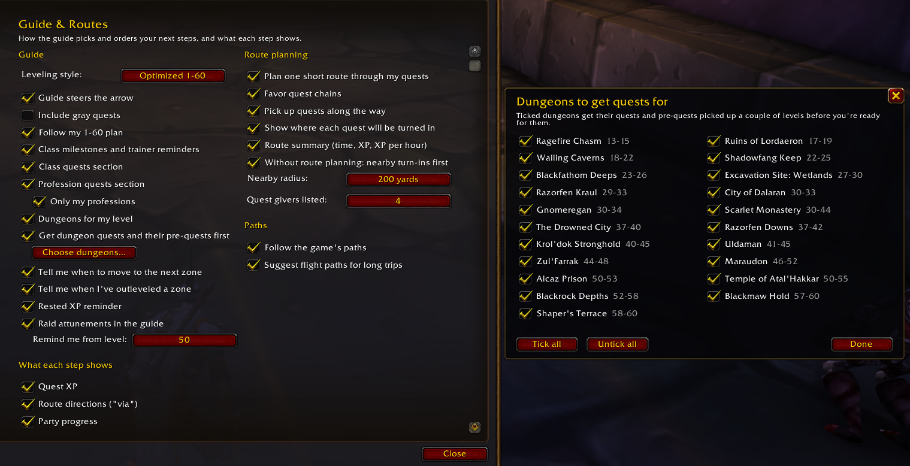
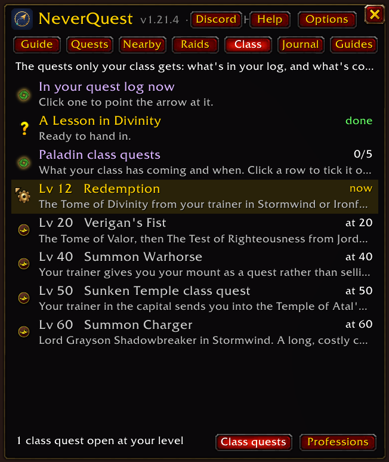
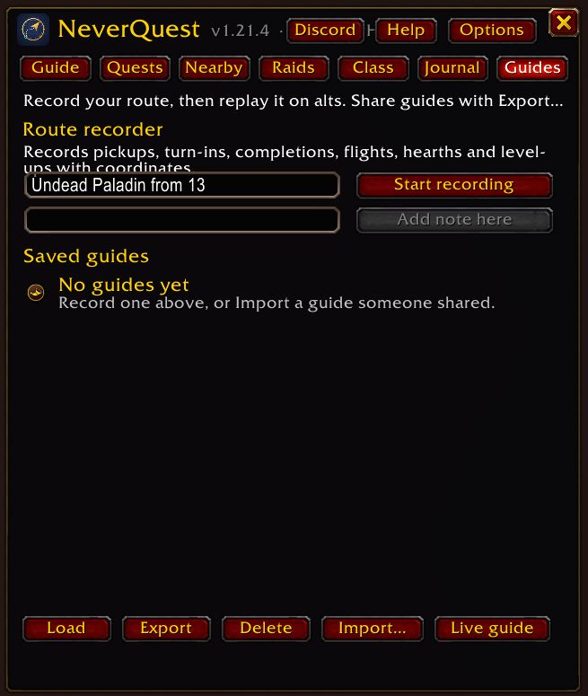
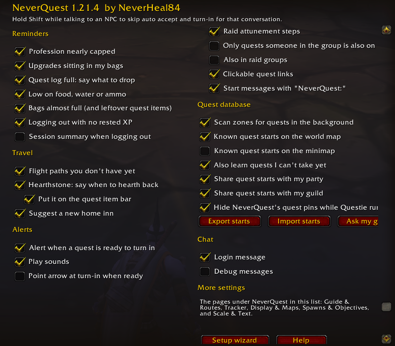
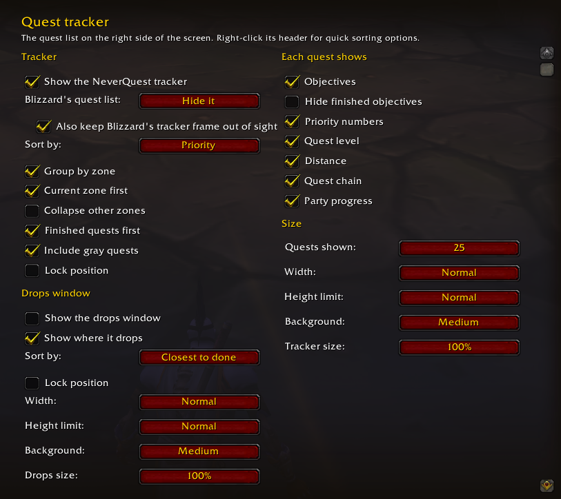
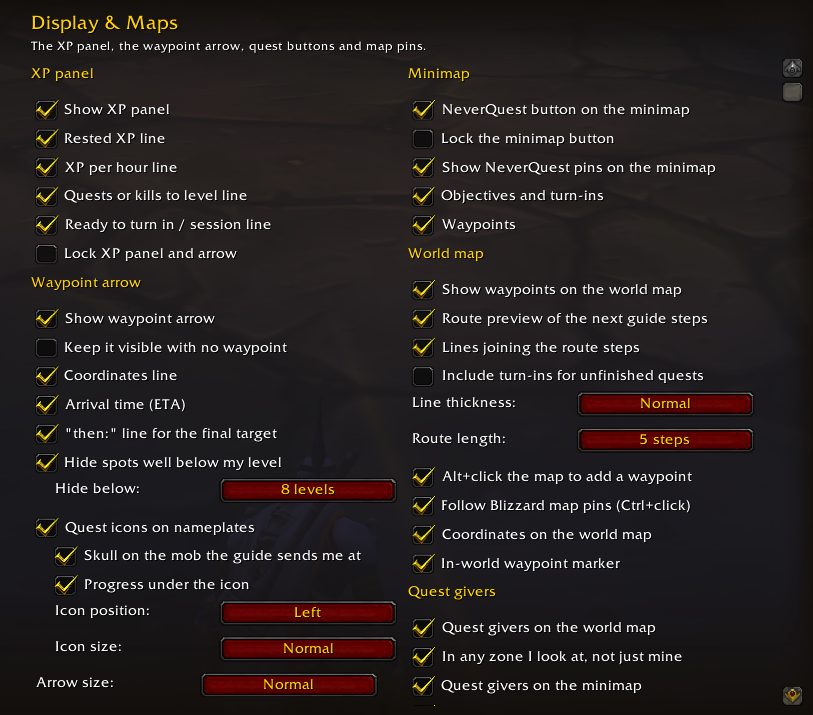
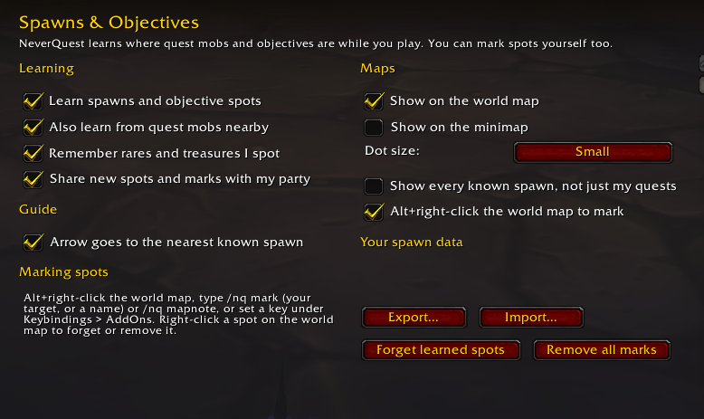
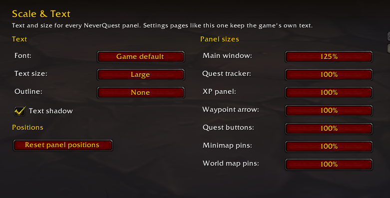

# NeverQuest screenshots

Taken in WoW Forever with NeverQuest 1.21.4 and 1.21.7.

## Guide & Routes options and choosing dungeons
Tick the dungeons you want quests for. Their quests and pre-quests get picked up a couple of levels before you're ready to run them.

## Class quests
What your class has coming and when, plus class quests already in your log. Click a row to point the arrow at it.

## Professions
The quests your professions wait on, and the skill each one needs.

## Route recorder and guides
Record your route, then replay it on alts. Share guides with Export and Import.

## Options: automation, party and announcements

## Options: reminders, travel, alerts and the quest database

## Options: quest tracker and drops window

## Options: display and maps
The XP panel, the waypoint arrow, nameplate icons, minimap and world map pins.

## Options: spawns and objectives
NeverQuest learns where quest mobs and objectives are while you play. You can mark spots yourself too.

## Options: scale and text
Font, text size and the size of every NeverQuest panel.

